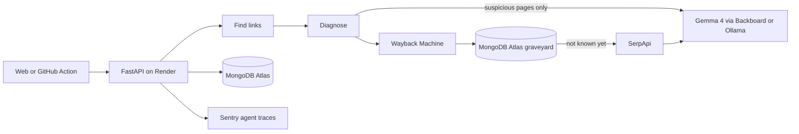

# Linkmortem

**Every dead link is a ghost.** Linkmortem finds the dead links and dead sections in a website or in the Markdown docs of a GitHub repository, works out why each one died, recovers what the page said from the Internet Archive, looks for where the content lives now and writes the fix. Gemma 4, an open weights model, reads the pages that code alone can't judge.

**Live:** [linkmortem.tech](https://linkmortem.tech) · **Example autopsy:** [linkmortem.tech/r/J1TS79vOe1kw](https://linkmortem.tech/r/J1TS79vOe1kw) · **GitHub Action demo:** [pull request](https://github.com/carlosjcastro/linkmortem-playground/pull/1) and [issue](https://github.com/carlosjcastro/linkmortem-playground/issues/2) in linkmortem-playground

Built for the DEV Hacktoberfest Open Source AI Challenge, Week 4, "Ghost in the Machine".

## The autopsy

Every scan follows the same six steps.

1. **Find.** Collects up to 150 links from up to 12 pages of a site, or from up to 40 Markdown files of a public repository at an exact branch or commit. Relative links are resolved against the repository. When a limit cuts the scan short, the results say how many links and files were left out.
2. **Diagnose.** Checks each link and names the cause of death: not found, gone, dead domain, parked domain, error page in disguise, empty placeholder, unrelated redirect, missing section. Bot checks, login walls and pages that only render with JavaScript are reported as unconfirmed, never as dead. A failure that may be temporary is retried once before any verdict.
3. **Remember.** Finds the last healthy copy in the Wayback Machine and checks that the copy itself isn't an error page.
4. **Reincarnate.** Searches the web for the same content at a new address and asks Gemma whether a candidate is the same page, a newer version or something else. Scrapers and lookalikes don't count.
5. **Rest.** Builds a `git apply` patch that replaces each dead link with its new home, or with its archived copy when there is no new home.
6. **Preserve.** Asks the Internet Archive to save the links that are still alive, before they become ghosts too.

Links to a section of a repository document, like `README.md#install`, are checked against the headings and anchors of that document, computed the way GitHub does. When the section is gone, the closest heading becomes the replacement, with no model involved.

The same dead link found in several files is fixed in all of them.

Results can be shared for 30 days at `linkmortem.tech/r/<id>`, with a link preview that names the ghosts found, and each autopsy is drawn as a haunted house: the windows light up in proportion to the living links, and every dead link rests in a grave with its ghost. Selecting a ghost jumps to its autopsy.

## The model proposes, the code decides

Anything code can verify is decided by code: HTTP status, DNS, parked domains, bot checks, meta refresh, candidate relevance. Gemma only judges what code can't read, such as a page that answers 200 but says "this content no longer exists". A link is a ghost only with evidence, and unreadable content is never evidence of death.

In production, Gemma is called for roughly one link in ten. Every call is traced in Sentry with its prompt, answer, tokens and cost.

Pages from the internet are fenced as data in every prompt. One of the repositories used for testing links to a page that tries a prompt injection on AI crawlers; Gemma kept classifying it.

## Use it

### On the web

Paste a site or a repository at [linkmortem.tech](https://linkmortem.tech), or try the demo repository in one click. Repositories can point at a branch or commit with `/tree/<ref>`. The results of a repository include the workflow below, ready to copy.

### As a GitHub Action

Scan the Markdown of a repository every week, keep one issue with the latest report and open one pull request with the replacements Linkmortem can prove.

```yaml
name: Linkmortem

on:
  workflow_dispatch:
  schedule:
    - cron: "17 9 * * 1"

permissions:
  contents: read

jobs:
  links:
    runs-on: ubuntu-latest
    permissions:
      contents: write
      issues: write
      pull-requests: write
    steps:
      - uses: actions/checkout@v7
      - uses: carlosjcastro/linkmortem@main
        with:
          backboard-api-key: ${{ secrets.BACKBOARD_API_KEY }}
          serpapi-api-key: ${{ secrets.SERPAPI_API_KEY }}
          open-pull-request: "true"
          open-issue: "true"
```

Opening pull requests also needs **Settings → Actions → General → Workflow permissions → Allow GitHub Actions to create and approve pull requests**.

| Input | Default | What it does |
| --- | --- | --- |
| `repository` | the current repository | Repository to scan, as `owner/name` |
| `ref` | the commit being run | Branch, tag or commit to scan |
| `github-token` | `github.token` | Reads the repository through the GitHub API |
| `backboard-api-key` | empty | Lets Gemma judge suspicious pages through Backboard. Without it, code checks still run |
| `backboard-model` | `google/gemma-4-26b-a4b-it` | Model served by Backboard |
| `serpapi-api-key` | empty | Looks for where dead pages live now |
| `fail-on-ghosts` | `false` | Fails the step when ghosts are found |
| `open-pull-request` | `false` | Opens or updates one pull request with the proven replacements |
| `open-issue` | `false` | Keeps one issue with the latest report, comments only when ghosts appear or are laid to rest and closes it when none are left |

Outputs: `ghosts`, `unknown`, `report`, `replacements`, `pull-request` and `pull-request-status` (`opened`, `updated`, `unchanged`, `conflict` or `edited-by-people`). The job summary shows the report and links the pull request and the issue.

This repository runs the Action on itself every Monday and on every pull request that touches Markdown.

The pull request is careful by design:

- Only proven replacements: a new home Gemma judged as the same page or its successor, or the last healthy archived copy.
- Whole links only, so fixing `https://old.dev/a` never touches `https://old.dev/abc`, and never inside code blocks or inline code.
- One pull request on the `linkmortem/rest` branch, updated instead of duplicated and left alone when nothing changed.
- It never forces a patch that no longer applies, never overwrites a branch someone edited, never reopens a closed pull request and never merges.
- Each row of the description says why the old link died and what backs the new one.

### From the command line

```
cd backend
python -m app.cli https://github.com/owner/repo --report report.md --patch linkmortem.patch
```

## Open models, measured

Linkmortem captured 60 prompts from scans of old repositories and labeled 55 of them, then replayed them against nine open weights models through a single Backboard API key. A costly error is calling a living page dead or accepting a different page as the new home.

| Model | Accuracy | Costly errors | Median latency |
| --- | --- | --- | --- |
| Gemma 4 31B | 98% | 0 | 2.98 s |
| **Gemma 4 26B A4B (production)** | **95%** | **0** | **1.22 s** |
| Llama 4 Scout (JSON by prompt) | 93% | 4 | 5.06 s |
| DeepSeek V3.2 | 91% | 3 | 4.29 s |
| Qwen3 30B A3B Instruct | 91% | 3 | 2.57 s |
| Gemma 4 e4b, local with Ollama | 87% | 1 | 0.72 s |
| Gemma 3 27B | 87% | 5 | 2.48 s |
| Ministral 14B | 79% | 10 | 1.86 s |
| Gemma 3 4B | 67% | 10 | 1.29 s |

Gemma 4 26B runs in production: no costly errors, the fastest of the cloud models and less than half the input price of Gemma 4 31B. Labels were proposed with AI help and reviewed by hand. The tools live in `backend/evals`.

## How it's built



| Piece | Role |
| --- | --- |
| **Gemma 4** | Classifies suspicious pages and compares candidates for a new home. Local with Ollama or in the cloud |
| **Backboard** | Serves Gemma in production and ran the comparison of nine open models with one API key |
| **Internet Archive** | Wayback Machine for the last healthy copy, Save Page Now to preserve living links |
| **SerpApi** | Live web search for the new home of a dead page, with a cap per scan and a daily budget so one busy day can't spend the whole monthly quota |
| **MongoDB Atlas** | Shared autopsies, a 7 day cache of memories and new homes, and a graveyard with Vector Search and Automated Embedding that answers before spending a search |
| **Sentry** | Agent tracing: one `invoke_agent` per scan, `execute_tool` for each step and `gen_ai.chat` for each Gemma call, with prompts, answers, tokens and cost |
| **GitHub Actions** | CI, the reusable Action, the weekly scan of this repository, the automatic pull request and the issue |
| **GitHub Copilot** | The coding agent wrote the first security and contributing guides in [PR #3](https://github.com/carlosjcastro/linkmortem/pull/3), fixed after human review |
| **Render** | Runs the API and the interface from a two stage Docker image |
| **Three.js** | The ghost on the home page and the haunted house of each autopsy |

The backend is Python 3.12 or newer with FastAPI, httpx2, Pydantic and PyMongo. The interface is React 19 with Vite, Tailwind CSS and Three.js, in English and Spanish.

## Security

- Every request, and every redirect hop, resolves DNS and only reaches public addresses on ports 80 and 443, with at most 5 redirects and 400 KB per page.
- Scans are limited per client and in total.
- Text from the internet is fenced as data in prompts and escaped in reports and pull requests.
- Patches are built on the server from the saved autopsy, never from what the browser sends.
- Each autopsy can be preserved only once, to respect the Internet Archive.
- Every response carries a strict Content Security Policy, HSTS, `nosniff`, `no-referrer`, a Permissions Policy and a Cross Origin Opener Policy. The container runs without privileges.
- Sentry receives the agent traces, including the prompts and answers built from public pages, but never IP addresses, cookies or request bodies.

See [SECURITY.md](SECURITY.md) to report a vulnerability.

## Run it locally

Backend, from the `backend` folder:

```
python -m venv .venv
.venv\Scripts\activate
pip install -r requirements_dev.txt
copy .env.example .env
ollama pull gemma4:e4b
ruff check .
python -m pytest
python -m uvicorn app.api:app
```

On macOS or Linux, use `source .venv/bin/activate` and `cp .env.example .env`.

Frontend, from the `frontend` folder:

```
npm ci
npm run format:check
npm test
npm run dev
```

Everything works with Ollama alone. Each key in `.env` turns on one more piece:

| Variable | Turns on |
| --- | --- |
| `LINKMORTEM_MODEL_PROVIDER=backboard` and `BACKBOARD_API_KEY` | Gemma through Backboard instead of Ollama |
| `SERPAPI_API_KEY` | Searching for new homes |
| `MONGODB_URI` | Shared autopsies, cache and graveyard |
| `ARCHIVE_ACCESS_KEY` and `ARCHIVE_SECRET_KEY` | Preserving living links |
| `SENTRY_DSN` | Agent traces |
| `GITHUB_TOKEN` | 5,000 GitHub requests per hour instead of 60 |

## Deploy

`render.yaml` describes the service as a Render Blueprint: the Docker image, the health check at `/api/health`, deploys only after checks pass, and every secret requested at creation instead of stored in the repository.

## Built with AI

Claude helped plan the work, write and review code, label the evaluation cases and debug. GitHub Copilot's coding agent wrote part of the documentation. Every change was reviewed and committed by hand.

## License

[MIT](LICENSE)
